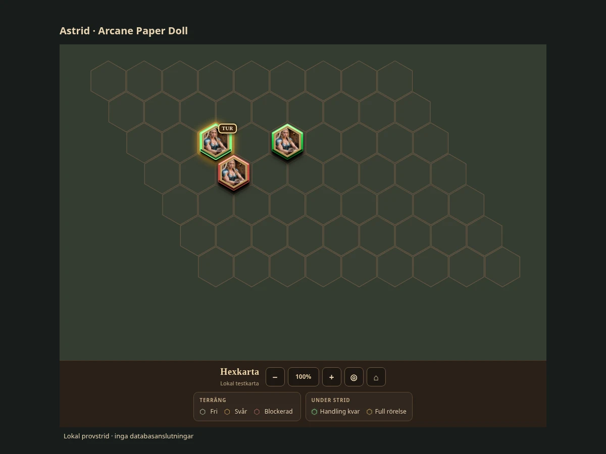
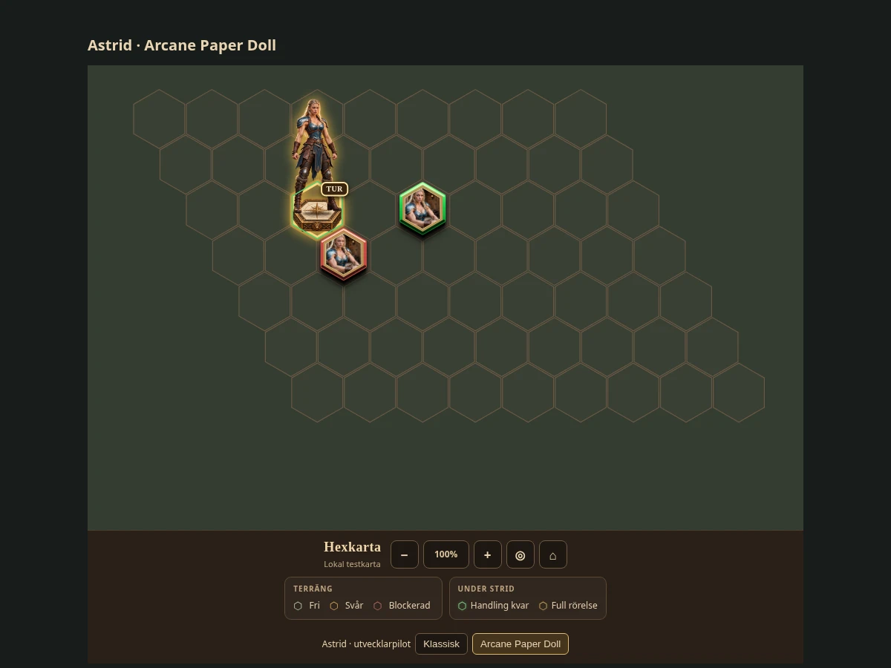
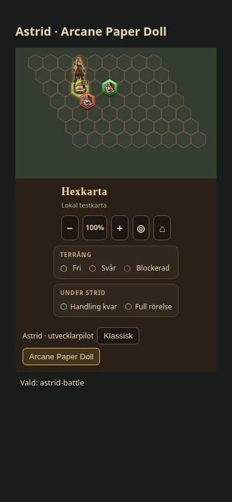

# OPERATION ARCANE PAPER DOLL – Astrids stridspilot

## Prova piloten

Öppna appen med `?arcanePaperDoll=1` (eller `&arcanePaperDoll=1` om URL:en redan har parametrar), gå till stridsvyn och använd **Klassisk / Arcane Paper Doll** under kartan. Även utvecklarläget startar i Klassisk. Valet finns bara i sidans minne och återställs vid omladdning. Utan parametern skapas ingen pilotkontroll och pilotbilden hämtas inte.

Endast en `character` med käll-ID `astrid`, eller Astrids databas-ID via den redan inlästa rollpersonen med `data.id === 'astrid'`, omfattas. Namnmatchning används inte. Saknad identitet eller misslyckad bildladdning lämnar den klassiska markören kvar. Övriga rollpersoner, SLP och monster får exakt samma markörmarkup som tidigare.

## Inventering av dagens rendering

All kod nedan finns i `features/combat/runtime.js`:

- `combatMiniatureVisual()` väljer först en separat stridsikon, annars porträttet. Rollpersoner läses från redan inlästa `chars`; SLP och monster använder register/cache eller stridens sparade bildreferenser.
- `combatPlayerMiniatureSvg()` ritar bilder som upphöjda SVG-hexbrickor. En SVG-`clipPath` beskär själva porträttet. Saknad bild använder befintliga SVG-miniatyrer för Astrid, Lyra och Evalin, annars cirkel och initialer i `renderCombatMap()`.
- `renderCombatMap()` placerar markören i hexens centrum eller förflyttningsplanens förhandsposition. Flerhexfigurer förankras i fotavtryckets medelpunkt. Markörerna sorteras efter Y-koordinat.
- Den yttre `.combat-token-group` bär ID, klick och eventuell förflyttningsdragning. Porträttbrickans `.combat-mini-hit` är en separat transparent rektangel med samma translation och skala som brickan.
- Turhalo, TUR-märke och flerhexfotavtryck ritas separat. Förflyttningens transparenta klickpolygoner ritas sist, över alla miniatyrer, så dubbelklick kan genomföras även över förhandsmarkören.
- `src/styles/app.css` styr lagfärg, vald markör, attackmål, aktiv tur och rörelseplanering.

## Pilotens avgränsning och förankring

Den klassiska miniatyrrenderaren är oförändrad. `runtime.js` får bara två anrop: frivilliga kontroller i kartfoten och ett frivilligt bildbyte efter den vanliga markörrenderingen. Pilotens kod och CSS finns i `features/combat/astrid-paper-doll.{js,css}`.

Vid bildbyte behålls originalmarkörens DOM, transformering och klickyta i ett visuellt dolt lager; klickytan förblir synlig för SVG:s hit-testning. Den nya figuren har `pointer-events:none`, så överhänget inte fångar klick från närliggande hexar. Ursprungliga klick-, drag-, förflyttnings- och stridsfunktioner anropas fortfarande av samma yttre grupp. Besegrad Astrid behåller dödskallemarkören.

Källbilden är **900 × 780 px**. Hexbasens övre yta har centrum **(451, 604)** och bredd cirka **216 px**. Enhetlig bildskala är:

```text
bildskala = √3 × karthexens radie × 0,94 / 216
bildens x = −451 × bildskala
bildens y = −604 × bildskala
```

Basens bredd blir 94 % av karthexens bredd. Figuren får resa sig över basen utan porträttets hexklippning. Skalan följer karthexen även under den klassiska miniatyrens minimiskala. Kartans befintliga pan/zoom, viewport och Y-sortering behålls. Piloten utökar inte kartans yttre viewport.

## Bildkälla och HERMES

Användarens `24813.png` är oförändrad. Originalet har arkiverats i befintligt HERMES-originalarkiv och hämtats tillbaka med identiska bytes och SHA-256:

- [Arkiverat PNG-original](https://drive.google.com/file/d/1W5WQqxcLgN5Ks1Em-H9gM59kTvRQ3-uA/view).
- Källans SHA-256: `b28061ae78ca98c0b55c8b3647d402257c33064534ac7e39866a5fd050ac406c`.
- Appens separata derivat: `features/combat/astrid-paper-doll.webp`, **167 102 bytes**, lossless WebP med `exact=True`.
- Samtliga avkodade RGBA-pixlar är byte-identiska med PNG-originalet, inklusive alfa. Bildmått och tomma marginaler är bevarade.
- Fullständig metadata och visningsfilens SHA-256 finns i `features/combat/astrid-paper-doll.json`.

Inga PNG-original läggs i Git. PR:n innehåller ett separat WebP-derivat för denna visuella pilot; ingen Storage-publicering eller HERMES-aktivering körs. **Ändrade DB-referenser: inga.** Inga migrationer, tabeller, policies, aktiva bildpekare eller befintliga original ändras.

## Verifiering och begränsningar

`npx vitest run tests/astrid-paper-doll.test.js`: **6/6 passerar**. Kontrollerar avstängt utvecklarläge, Klassisk som standard, återställning, exakt Astrid-identitet, oförändrade andra figurer och data, bevarad klickmarkup, linjär skala samt laddning och bildfel.

`node scripts/astrid_paper_doll_visual.cjs` efter `python -m http.server 4174 --bind 127.0.0.1`: **passerar i Chromium**, 1200, 768 och 390 px. Den lokala fixturen använder appens riktiga kart-, miniatyr- och kartfotsrenderare med syntetiska stridsdata. Kontrollerar byte-identisk klassisk kartmarkup, oförändrad Lyra/fiende och klickyta, markörklick, klick genom överhänget, turbyte, målmarkering, förflyttningens klicklager och dubbelklick samt besegrad markör. Fixturens förflyttningskommando är lokalt; inga DB-anrop görs.

Full `npm test`: **1285 passerar, 29 fallerar**. Oförändrad bas `59f9815c1b5bb1739ab027283fcc44ff15477c39`: **1279 passerar, exakt samma 29 fallerar**. Inga nya fel. `npm run build` kraschar med **exit 139 / Segmentation fault** efter Vites modultransformering på både pilotgrenen och den isolerade, oförändrade basen. Produktionsbygget kan därför inte verifieras i denna miljö.

Inloggad livekampanj och riktiga DB-skrivande stridskommandon har inte provats. Ingen merge eller driftsättning har gjorts. Underlag finns i [result.json](evidence/astrid-paper-doll/result.json) och [validation.json](evidence/astrid-paper-doll/validation.json).

### Klassisk, dator



### Arcane Paper Doll, dator



### Arcane Paper Doll, 390 px


