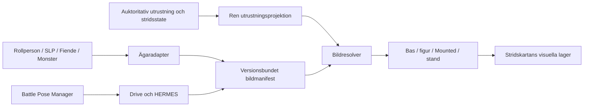

# OPERATION MOZAMBIQUE
## OPERATION ARCANE PAPER DOLL – DANIEL-LYX · teknisk rekognosering, fas 1 av 9

**Datum:** 2026-10-21 UTC. **Status:** inventering och implementationsförslag, ingen implementation.

**Analysbas:** [main, 64346c8f3ac0f6b9f02ad0684a0a1ec403008f22](https://github.com/lindkvistfoto-dot/alea-crusaders/commit/64346c8f3ac0f6b9f02ad0684a0a1ec403008f22), inklusive mergad [PR #136](https://github.com/lindkvistfoto-dot/alea-crusaders/pull/136). GitHub Compare bekräftade status `identical`, 0 commits och 0 filer mellan denna commit och main. Lokal arbetsgren heter `work`; HEAD är samma commit. Alla kodhänvisningar gäller denna bas.

Rapporten bygger på källkod, migrationsfiler, befintliga testfall, skrivskyddad SQL mot projekt `wbmosmkirsitkonejzpg`, Drive-metadata samt verkliga bytes från de två nya originalen. Aktuella registerantal är en ögonblicksbild över projektet, utan filter på aktiv kampanj eller `active`. Föreslagna namn, API:er och tabeller nedan finns ännu inte.

### Rekommenderat beslut

Bygg ett gemensamt bildsystem med typade adaptrar för de befintliga registren, en ren utrustningsprojektion, en deterministisk resolver och en gemensam Battle Pose Manager. Behåll stridsreglernas befintliga datakällor. Bilder, laddningsfel och fallback får aldrig skriva utrustning, FV, GL, ammunition, handlingar, initiativ eller hexgeometri.

Börja BENGALI med kontrakt och exekverbara kompatibilitetsfall bakom avstängd funktion. Databas och HERMES utökas i efterföljande separata PR:er. Skala inte upp Astrids hårdkodade pilot till ett register genom fler specialfall.

Tre avgörande luckor:

1. Fiende är en adminkategori i samma tabell som monster, inte en egen normal källtyp i striden.
2. Sex riktningar och flerhex finns; Mounted-relation, sittpunkter och masklager saknas.
3. HERMES 4.0 fungerar för befintliga mål men saknar måltyper, bildprofiler och aktiveringsfält för Battle Pose och de nya systembaserna.

## 1. Befintlig arkitektur och kombattantregister

Appen använder Vite 8, klassiska JavaScript-skript och globala funktioner, främst i `legacy/app.js`, `features/combat/runtime.js` och `features/combat/admin-scenes.js`. Den är inte en React-app. `index.html` styr skriptordning. Supabase nås via befintlig `dbJson` och Storage-hjälpare.

### 1.1 Fyra användartyper, flera identitetsnivåer

| Användartyp | Master och identifierare | Bilder i dag | Administration och livslängd |
|---|---|---|---|
| Rollperson | `characters.id` UUID, `campaign_id`, `owner_id`, `data` JSONB. Lokalt `data.id`, hydrerat DB-ID i `_dbId`. | `data.portrait`; inbyggt Astrid-porträtt via `getPortraitSrc`; kolumn `combat_icon_path` läses som `combatIconPath`; `data.figureImages.base/armored`. | Rollpersonens Grund/Bilder och aktuell utrustning. Kampanjbunden DB-post, återanvändbar mellan strider. `is_npc`/ägaren SLP gör inte posten till `campaign_npcs`. |
| SLP | `campaign_npcs.id`, `campaign_id`, `npc_key`; valfri `source_global_npc_id`. | `image_path`, `combat_icon_path`. Ingen gemensam cutout-kolumn. | `editCampaignNpc`/`saveCampaignNpc`. Kampanjmaster; striden har en separat utrustningskopia. |
| Fiende | `campaign_monsters.id`, `campaign_id`, `monster_key`, `actor_kind='enemy'`. | `image_path`, `combat_icon_path`. Ingen gemensam cutout-kolumn. | `renderAdminActorTable(...,'enemy')`, `editCampaignMonster`/`saveCampaignMonster`. Kampanjmaster. |
| Monster | Samma tabell, `actor_kind='monster'`; `quantity` kan skapa flera instanser. | Samma bildfält som fiende. | Samma editor med kategorin monster. Flera stridsinstanser måste kunna dela posebibliotek och ha egen riktning/utrustning. |

Permanent kampanjoberoende stöd finns för **SLP** i `global_npcs`: UUID, unik `npc_key`, `image_path`, `image_reference`, JSON-profiler och `active`. Biblioteket i [global-library.js](../../features/npc/global-library.js) läser och kopierar poster; det erbjuder inte samma fullständiga redigerare/uppladdare som kampanjeditorn. Den senare versionen av RPC `add_global_npc_to_campaign` kopierar porträtt och regler, skapar en ny kampanjpost och behåller referens till originalet. Kampanjändringar skriver inte tillbaka.

Inget motsvarande permanent fiende-/monsterbibliotek eller kampanjoberoende rollpersonsregister hittades i denna bas. Systemet bör kunna få sådana ägare senare, men de ska inte byggas som ett dolt villkor för Battle Pose.

Striden använder `combatants.id` som instans-ID och `source_type/source_id/source_instance_key` som proveniens. Normala typer är `character|npc|monster`; fiender använder `monster`. Sceneditorn har dessutom `combatant_type=player|npc|enemy|monster`. DB tillåter också `quick_enemy` med `source_id=null`, enligt [quick_enemy-migrationen](../../supabase/migrations/20261004_quick_enemy_foundation.sql). Den aktiva runtime-filen saknar motsvarande namngivna snabbfiendeflöde. Adaptern ska ändå kunna ge en sådan instans säker fallback utan att slå upp null-ID eller namnmatcha.

### 1.2 Verifierad bildtäckning

| Register | Poster | Explicit porträttfält | Separat stridsikon | Befintliga helfigurer |
|---|---:|---:|---:|---|
| Rollpersoner | 3 | 2 | 0 | 3 base, 1 armored |
| Kampanj-SLP | 7 | 7 | 0 | Inget gemensamt fält |
| Fiender | 2 | 2 | 0 | Inget gemensamt fält |
| Monster | 1 | 1 | 1 | Inget gemensamt fält |
| Permanenta SLP | 4 | 4 | Inget eget fält | Inget gemensamt fält |

Astrids inbyggda porträtt tillkommer utöver de två explicita rollpersonsfälten. Att ett helfigurfält finns bevisar inte att bilden är en transparent cutout eller visar kompatibel utrustning. Inga av dessa bilder är därmed automatiskt godkända Battle Pose-reserver.

### 1.3 Befintliga uppladdningsvägar

- [legacy/app.js](../../legacy/app.js): `handlePortraitFile` skapar rollpersonsporträtt som JPEG-data-URL, max 900 px långsida. `prepareCombatIconBlob` beskär till kvadrat och skapar 320×320 WebP. `uploadCombatIconAsset` använder privata `combat-icons`. Dessa ikoner får inte behandlas som kompletta helfigurer.
- Samma fil: `beginAdminNpcDraft`, `adminNpcPortraitHtml`, `prepareNpcPortraitBlob`, `uploadNpcPortraitAsset`, `persistAdminNpcPortrait`, `beginAdminCombatIconDraft`, `persistAdminCombatIcon`. NPC-porträtt skapas som WebP, max 1000 px, i privata `campaign-actor-images`. Befintliga ersättningsflöden kan radera föregående objekt; det beteendet ska inte kopieras till nya versionsbundna poser.
- [figure-images.js](../../features/character/figure-images.js): lokal `uploadFigure` skapar WebP-data-URL med alfabevarande canvas, max 1400 px, och sparar i rollpersonens JSON. Två bildplatser: `base` och `armored`. Varken vapensignatur, riktning eller Mounted finns.
- [scripts/hermes_npc_portraits.py](../../scripts/hermes_npc_portraits.py): särskild Drive-JPEG→WebP→`global_npcs.image_path`-pipeline. Detta är en separat befintlig porträttväg med snäv JPEG-validering, inte ett färdigt Battle Pose-intag.
- [campaign-content.js](../../campaign-content.js) innehåller äldre parallella kampanjeditorer. De senare funktionerna i `legacy/app.js` är rikare. BENGALI ska kontrollera faktisk skriptordning och undvika att koppla enbart en äldre dublett.

Gemensam Manager öppnas från rollpersonens Bilder, SLP-editor, fiende-/monstereditor samt permanent SLP-bibliotek. Vid ny osparad post krävs först stabilt DB-ID; lokalt `data.id` används inte som global poseägare.

## 2. Utrustning och automatiskt bildval

### 2.1 Verifierad representation

| Fall | Befintlig representation och funktioner | Konsekvens för bildsystemet |
|---|---|---|
| Höger/vänster | `currentEquipment.rightHand/leftHand`: `{kind,itemId,hands,primaryHand,...}`. `itemId` avser utrustningsinstansens `equipId`. | Bevara anatomisk hand, inte bildens högra/vänstra sida. |
| Vapentyp | `weaponTypeId` eller `weapon_id` → `rule_weapons.id`; `copyRuleWeaponToInstance` kopierar masterdata. | Matrixrader ska använda UUID, inte namn, ikon eller FV-färdighet. |
| Sköld | Handreferens `kind='shield'`; instans i `shields`. NPC-master har `shield`-objekt och `hand`. | Sköld måste finnas i rätt hand; en ospecificerad sköldmatch kräver godkänd sköldklass. |
| Två händer | Samma `itemId` i båda händer, `hands=2`. `weaponGripRule`, `weaponGripForCharacter`, `refreshEquippedWeaponGrip`. | Deduplicera till ett vapen med tvåhandsfattning. Bildkod får inte anropa den muterande grip-refreshen. |
| Dubbla vapen | Två olika instans-ID:n; två instanser kan ha samma master-UUID. | Två dolkar är två vapen även när master är samma. Ambidextri styr handlingar, inte om de båda syns. |
| Avstånd/kast | `category/weaponCategory=projectile|thrown`, `projectile_key`, `combatWeaponProjectileKey`, `combatAmmoStock`. | Slut på pilar tar inte bort bågen ur händerna; kastat föremål kan däremot lämna handen. Skilj synlig utrustning från attackval. |
| Obeväpnad | `combatActionWeapon` kan ge `{name:'Obeväpnad',_unarmed:true}` för vald handling. | Ett obeväpnat attackval bevisar inte tomma händer. Visa inte automatiskt en tomhänt pose när aktören fortfarande håller föremål. |
| Övrigt i hand | `kind='equipment'`, t.ex. lykta eller bok. | Kräver specialsignatur eller utrustningsneutral reserv; får inte tolkas som tom hand. |
| SLP/monster | Mastervapen har `hand=none|left|right|both`. `combatNpcNormalizeProfile` ger gemensamma handreferenser och legacy-standard. | Använd samma normaliserade läsvy som striden och dokumentera när äldre data bara ger en antagen standard. |

Viktiga kodpunkter: [legacy/app.js:500](../../legacy/app.js#L500) för greppregler, [runtime.js:334](../../features/combat/runtime.js#L334) för NPC-normalisering, [runtime.js:3330](../../features/combat/runtime.js#L3330) för `combatAttackProfile`, `combatAvailableWeapons` och `combatWeaponKey`, samt [runtime.js:3750](../../features/combat/runtime.js#L3750) för primär hand, ambidextri och handlingsvapen.

`1H`, `1-2H` och `2H` är regelvärden. För `1-2H` beror handantalet på STY-grupp. Även GL ½ kan vara ett lagligt regelutfall; bildsystemet får inte hitta på en strängare regel. `weapon_type=L|T` och `skill_id` beskriver andra egenskaper och får inte ensamma användas som visuell vapentyp.

### 2.2 Auktoritet och uppdateringar

`combatAttackProfile` prioriterar stridsinstansens `state.attack_profile` för SLP/monster. Rollpersoner läser den redan inlästa rollpersonen och använder sparad profil som reserv. `combatSaveNpcQuickEdit` sparar bara i pågående strid, använder `updated_at` som konfliktkontroll och laddar om striden.

`save` för rollpersoner skriver lokalt och köar central synk efter 350 ms. `combatPollPlayerView` pollar var femte sekund för spelare, men kontrollerar främst `combat_instances.updated_at/status`. Den är **inte** en generell prenumeration på utrustning eller bildregister. `combatLoadActorImageSources` cachar masterbilder och kan bli gammal. Den befintliga triggern för rollpersoners rundbakgrund synkar just rundbakgrund; den etablerar inget generellt utrustningsflöde.

Föreslagen integration:

1. Ren `readBattleLoadout(profile, combatState)` producerar en ny läsmodell från exakt samma auktoritet som striden. Den får inte fylla i, reparera eller spara regeldata.
2. Utrustningsbyte, NPC-snabbredigering, kast/tappat/brutet föremål, rotation och bildaktivering invalidierar berörd resolvernyckel. Använd befintliga regelhändelser; inför inte nya avdrag eller gratis handlingar.
3. Lokalt lyckat utrustningsbyte renderar om direkt. Nätverksklienter behöver ett uttryckligt versionsflöde för rollpersonsdata, stridsdata och posebibliotek. Starta med avgränsad versionspollning för synliga aktörer även på SL-klienten; använd inte enbart stridsinstansens timestamp. Samla läsningar och läs rollpersonskällan via den ordinarie synkvägen med skydd för osparade lokala ändringar.
4. Realtime kan ersätta pollningen i en senare optimering om publication, RLS och klientlivscykel verifieras. Det stödet är inte verifierat här.
5. Cache omfattar aktör/instans, utrustningssignatur, poseversion, facing, fotavtryck, Mounted-relation och behörighetskontext. Rensa vid kampanjbyte/logout. Expirerad signerad URL förnyas en gång; nekad fil nedgraderas direkt.
6. Vid asynkront bildbyte får föregående bild stanna endast om den fortfarande är kompatibel. Svärd→båge får aldrig behålla svärdsbilden i väntan på laddning. Använd säker reserv direkt och ignorera sena svar för äldre nyckel.

## 3. Föreslagen datamodell

Modellen är ett kontraktsförslag inför senare schema-PR, inte körbar migrations-SQL.

### 3.1 Ägare och versionering

**`battle_art_sets`**: UUID, monoton revision, status, `campaign_id` där relevant, och exakt en typad ägar-FK: `character_id`, `campaign_npc_id`, `campaign_monster_id`, `global_npc_id` eller `combatant_id` för uttrycklig instansöverstyrning. CHECK kräver en ägare; en master har högst ett aktuellt set. Korsvis kampanjintegritet verifieras med sammansatta FK där det går och en kontrollerad skrivväg i övrigt. En obevakad polymorf `owner_type/owner_id` utan FK rekommenderas inte.

Alla fyra UI-typer går genom samma kontrakt; `actor_kind` är adaptermetadata, inte en extra kopia av monsterregistret. Rollpersonens lokala alias mappas till `characters.id` innan skrivning.

**`battle_art_versions`**: immutable publicerade versioner av ett set. Ett set pekar på aktiv version med compare-and-set. En publicering av flera relaterade filer, t.ex. ryttarens masklager, aktiveras först när hela versionens obligatoriska filer är verifierade. Delfel i andra oberoende set får isoleras.

**`battle_pose_slots`**: UUID, setversion, `slot_key`, `kind=battle_pose|cutout`, `posture=standing|mounted`, `view=front|right|left`, valfria exakta facingvarianter 0–5, utrustningsvillkor, fotavtrycks-/layoutprofil, `asset_id` och status. Unik kanonisk `slot_key` per version. Tomma bildplatser är frånvaro av publicerad asset; inga tomfiler krävs.

**`battle_art_assets`**: immutable WebP-referens, bucket/path, SHA-256, byteantal, dimensioner, alfamått, ankare, markmått, rendergräns, sitt-/maskmetadata och HERMES-jobbreferens. Originalens Drive-proveniens ligger i skyddad metadata, inte i spelarens leveransmanifest.

**`combat_system_art`**: stabila nycklar för gemensam Bronze Ivory-bas och Arcane Portrait Stand, publicerad version och `asset_id`. Gemensamma baser registreras en gång. Föreslagna nycklar är `arcane-paper-doll-hexagon-base` och `arcane-portrait-stand`.

### 3.2 Utrustningskontrakt

Varje exakt slot innehåller en kanonisk signatur med:

- Anatomisk vänster/höger hand: `empty|weapon|shield|equipment|unknown`.
- Vapnets master-UUID, faktisk instansidentitet under normalisering och fattning `one_hand|two_hands`. Master-UUID blir normalt bildmatchningsnyckeln; ett unikt utseende kan dessutom få en explicit instansvariant.
- Sköldhand och valfri sköldmaster/visuell sköldklass. `any_shield` gäller endast om motivet granskats som kompatibelt med den klassen.
- Separata specialföremål, naturvapen och okända legacyfält. Okänt är inte samma sak som obeväpnat.
- Monteringsstatus och eventuell riddjurs-/sadelprofil. Flera riddjur kan dela profil endast när sittpunkt och masklager faktiskt är kompatibla.

En slot beskriver synliga föremål och tillåtna varianter. En generell pose som visar ett svärd är endast generell inom sin svärdskompatibla mängd. `equipment_neutral` får enbart sättas efter granskning av att bilden inte påstår något om aktuell handutrustning, exempelvis ett säkert huvudutsnitt.

Handordning bevaras i signaturen. Ingen automatisk spegling: den flyttar skölden till fel hand och kan spegelvända text/asymmetrisk rustning. En separat uttrycklig spegelgodkänning kan stödjas senare.

### 3.3 Behörighet, arv och kopiering

Rollpersonsbilder hanteras av samma ägare/SL/admin som rollpersonen. Kampanjmaster hanteras av kampanjens SL/admin. Permanent SLP-master skrivs av admin, enligt befintlig modell. En spelarvy ska få ett minimalt leveransmanifest för synlig kombattant, även när dess masterpost är SL-dold. Ge inte spelaren generell SELECT på `global_npcs`, utrustningshemligheter eller Drive-proveniens.

Föreslagen lösning är en avgränsad läsväg som kontrollerar medlemskap och synlig stridsinstans innan den lämnar de bildfält klienten behöver. Privata Storage-policyer eller kortlivade signerade URL:er ska kontrollera samma rätt. Skrivare kontrollerar både nuvarande ägare och nytt värde; nya publika tabeller kräver RLS och explicita grants i senare schema-PR.

När permanent SLP kopieras till kampanj: skapa ett kampanjägt set som refererar till **en pinnad publicerad version**. WebP kan delas utan dubbla bytes. Redigering skapar kampanjens egen version; originalet påverkas inte. Senare globala ändringar tillämpas genom ett uttryckligt uppdateringsval, inte genom tyst arv mitt i strid. Befintliga bilder massmigreras inte.

En strid kan ha en explicit instansöverstyrning. Standard är aktuell publicerad masterversion och aktuell utrustning. Avslutade strider kan pinna bildversion i ett separat presentationsmanifest för reproducerbar historik, utan att ändra historiska regelutfall.

## 4. Gemensam Battle Pose Manager och Daniel-lyx

Föreslagen popup `BattlePoseManager.open({owner, initialTab})` öppnas från samtliga fyra typer och permanent SLP-bibliotek. Samma komponent används med adapter för ägare, rättigheter och sparande.

### 4.1 Bildplatser

| Sektion | Bildplatser | Beteende |
|---|---|---|
| Battle Pose | Front (standard), Right, Left | Front kan publiceras ensam. Tomma sidovyer visar vald kompatibel fallback i förhandsvisningen. |
| Mounted | Front, Right, Left | Separat posefamilj för ryttare. Ingen stående helfigur återanvänds som sittande utan uttrycklig kompatibilitet. |
| Daniel-lyx | En rad per `rule_weapons.id`; två bildkolumner: Vapenslag respektive Vapenslag + sköld | Riktning och posture väljs ovanför matrisen; grundläge standing/front. Inga hundratals obligatoriska uppladdningar. |
| Kombinationer | Två vapen, tvåhandsfattning, vapen + specialföremål, naturvapen, sköld utan vapen | Lägg till endast validerade kombinationer med anatomiska handval och förhandsvisning. |

Varje matrisruta öppnar sloteditorn för bild, faktisk fattning, hand, valfri sköldklass och kompatibilitetsgranskning. `1-2H`-raden har en- och tvåhandsvarianter i samma ruta; sköldrutan gäller endast enhandsvarianten. För en viss kombattant filtreras valen genom dess befintliga greppregler. För permanent bibliotek kan lagliga profilvarianter visas utan att påstå att alla aktörer kan använda dem.

Båda bildkolumnerna behålls i matrisen; en ogiltig sköldkombination visar en inaktiv ruta med orsak och erbjuder ingen uppladdning. Tvåhandsbåge + sköld, tre upptagna händer och två separata vapen + sköld får inte skapas. Ambidextri får inte användas som bildkodens egen regel för att förbjuda en i övrigt utrustad dubbelvapenkombination.

Registret innehåller **60 mastervapen**: 44 melee, 10 projectile och 6 thrown. Det finns 18 olika `skill_id`, men dessa är inte 18 korrekta bildrader: spjut/lans, slunga/stavslunga och dolk/kastkniv delar delvis färdighet men har olika fattning eller utseende. Appendix A inventerar samtliga 60. Matrisen ska läsa aktuellt register dynamiskt, behålla redan publicerade referenser och inte hårdkoda antalet 60.

Förbered sidovyer i modellen från början men kräv bara en första godkänd bild. `missing`, `draft`, `verified` och `active` ska hållas åtskilda. Förhandsvisningen visar varför resolver valde en viss bild och vilka sex riktningar som saknar exakt vy.

### 4.2 UI och uppladdning

Popupen innehåller ägare och omfattning, flikar för basposer/Mounted/vapenmatris, sökning i vapenregistret, preview med utrustnings- och riktningsval, bildmetadata samt återställning till tidigare publicerad version. Tangentbord, Escape, fokusfälla och återfört fokus krävs; mobilvy ska visa samma två bildkolumner utan att sidans layout spricker.

Nya original ska genom Drive→HERMES. Manager ska i första leveransen välja redan verifierade HERMES-assets och visa väntande beställningar. En knapp som accepterar lokal PNG men bara sparar WebP till Storage skulle förlora originalarkivet. Direkt filuppladdning kräver därför en senare autentiserad intagskoppling som faktiskt arkiverar originalbytes i Drive; det finns inte i dagens popupflöden. Inga nya Base64-original eller stora bildsträngar ska lagras i rollpersonens JSON.

## 5. Bildresolver och säkra fallbackregler

Resolver är en ren funktion över normaliserad aktör, utrustning, facing, posture, layout och tillgängligt leveransmanifest. Den returnerar vald asset/lager, ankartransform, fallbacknivå, orsak och versionsnyckel. URL-laddaren är separat. Resolver skriver aldrig till DB eller stridsstate.

**Hårda filter före varje rangordning:** rätt aktör/version, rätt behörighet, aktiv och verifierad asset, kompatibel utrustning, kompatibel posture/montering och stödd fotavtrycksprofil. Samma filter gäller även cutout och generell pose.

| Prioritet | Val | Tillåten förenkling |
|---:|---|---|
| 1 | Exakt Battle Pose för utrustning, önskad vy/exakt facing och Mounted-status | Ingen, även fattning och handorientering måste matcha. |
| 2 | Närmaste kompatibla Battle Pose | Annan godkänd riktningsvy inom samma utrustning/posture; därefter uttrycklig godkänd visuell aliasgrupp. Aldrig bara liknande namn eller samma FV-färdighet. |
| 3 | Generell Battle Pose | Endast uttryckligt deklarerad utrustningskompatibilitet eller granskat neutralt motiv. |
| 4 | Cutout | Samma kontroll som ovan. Okänd gammal helfigur hoppas över tills den är klassificerad. |
| 5 | Porträtt i Arcane Portrait Stand på Bronze Ivory-bas | Säkert porträttutsnitt; behåll status/riktningsmarkeringar som separata överlägg. |

Om originalporträttet också visar tveksam vapenkombination används ett granskat huvudutsnitt. Saknat eller oläsbart porträtt ger initialer i samma stand. Om systembilderna inte kan laddas används en neutral geometrisk markör. Den sista nödfallbacken behövs för att kartan alltid ska förbli användbar.

Mounted får falla tillbaka till utrustningsneutralt porträtt/stand utan falsk stående ryttare eller fel riddjur; en separat statusmarkering anger Mounted. Bildresolver får aldrig gissa montering från namnet ”häst”, ett vapen som lans eller bildens utseende.

”Närmaste” bestäms deterministiskt: explicit vy/facing först; därefter godkänd kompatibilitetsnivå och minsta cirkulära avvikelse bland deklarerade `supportedFacings`; därefter aktiv versionsprioritet och stabilt slot-ID. Vänster/höger är ingen numerisk avståndsgissning. En variant för annan aktör eller Mounted-status räknas aldrig som nära.

Exempel på obligatoriska beteenden:

| Situation | Säkert val |
|---|---|
| Höger svärd + vänster sköld; bara svärd utan sköld finns | Hoppa över den posen. Använd kompatibel neutral reserv/porträtt. |
| Tvåhandssvärd; bara enhandsvärd + sköld finns | Hoppa över, även om namnen liknar varandra. |
| Front för rätt utrustning finns men Right saknas | Front enligt deklarerad riktningsfallback; logisk riktning och regler ändras inte. |
| Två dolkar med samma master-ID men olika equipId | Matcha dubbelvapen, inte ett enda tvåhandsvapen. |
| Bytt vapen medan gammal bild laddas | Visa säker reserv direkt; sen bild för gammal signatur ignoreras. |
| Cutout utan utrustningsmetadata | Hoppa över till granskning. |
| Slut på pilar men bågen är kvar i händerna | Bågpose kan vara kompatibel; bildkod skapar ingen ny ammunition. |
| Obeväpnad attack vald medan sköld hålls | Bildval följer handen, inte enbart attackens etikett. |

Befintlig `combat_icon_path` fortsätter fungera i klassiskt läge. Den blir inte automatiskt en ny Battle Pose eller en säker cutout. Den nya standardkedjan följer prioriteten ovan; gamla ikoner kan granskas och registreras i ett av dessa steg utan att ändra den gamla pekaren.

## 6. Stridskartan och PR #136

### 6.1 Vad som faktiskt finns

| Område | Verifierat i basen | Vad som behöver planeras |
|---|---|---|
| Astrid-pilot | [astrid-paper-doll.js](../../features/combat/astrid-paper-doll.js), CSS, WebP och JSON. Opt-in `?arcanePaperDoll=1`, börjar i Klassisk, tillstånd sparas inte. Exakt rollpersonsidentitet, inte namnmatchning. | Gemensamt register/resolver; ingen ny Astrid-speciallogik. |
| Bronze Ivory | Piloten använder en sammansatt figur med inbakad bas; ingen fristående gemensam Bronze Ivory-bas används i produktion av piloten. Klassiska markörer har SVG-bas/porträtthex. | Gemensam systemasset och tydligt `baseMode=embedded|shared` så att ingen dubbel bas ritas. |
| Turmarkering | `renderCombatMap` ritar separat guldhalo och TUR-badge. Badge kommer efter den egna bilden. | Skärmfast läsbarhet och översta badge-lager så nästa figur inte täcker TUR. |
| Kontaktskugga | Klassiska SVG-figurer använder ellips och filter; porträtthex har djup-/drop-shadow. Pilotens sammansatta konst har bildens egna detaljer. | Fristående markskugga och metadata `shadowMode=baked|shared`; undvik dubbla skuggor och glöd över bakgrundshinna. |
| Djup | Hela tokengrupper sorteras efter fotavtryckets Y-medelpunkt. | Stabil sortering med groundY, groundX och instans-ID. Komplexa lager inom monterad grupp. |
| Överlapp/dolda figurer | Höga bilder kan skymma varandra; ingen generell silhuett-/occlusion-resolver hittades. | Dolda figurer ska gå att identifiera via kontur och turordning. ”Dold bakom konst” är skilt från regelmässigt osynlig. |
| Guld/transparens | CSS på `.combat-miniature` kan lägga drop-shadow på hela bildens alfa. Val/attack/rörelse har egna färger. | Separera markring, aktiv tur och eventuell alfasilhuett; guldfilter får inte lägga sken runt ett halvtransparent rektangulärt bakgrundslager. |
| Klick | Yttre `.combat-token-group` har handler; transparent `.combat-mini-hit` är separat. Pilotkonst har `pointer-events:none`. Förflyttningens klickpolygoner ligger sist. | Behåll spelgeometrin, klick genom bildöverhäng och dubbelklick för förflyttning. Testa separata ryttare-/riddjursval. |
| Zoom/ankare | Klassisk skala `max(.55,g.size/42)`. Piloten skalar linjärt med verklig hexstorlek. Kartans zoom är 1–8. | Metadata per bildprofil; inga CSS-transformer som flyttar markankaret. Testa maxzoom och viewportens kanter. |

Källor: [runtime.js:3071](../../features/combat/runtime.js#L3071), [runtime.js:4934](../../features/combat/runtime.js#L4934), [runtime.js:5117](../../features/combat/runtime.js#L5117), [app.css:3120](../../src/styles/app.css#L3120), [app.css:7469](../../src/styles/app.css#L7469) och [pilotrapporten](astrid-arcane-paper-doll.md).

Piloten behåller klassisk markup i ett visuellt dolt lager för hit-testning. Den behåller också den klassiska namnbaserade figurreserven för Astrid/Lyra/Evalin när inget porträtt finns. Dessa reserver visar bestämda vapen och får inte ärvas av det nya systemets säkra fallback utan kompatibilitetsgranskning.

### 6.2 Förankring och lager

Pilotens bild är 900×780; basens toppcentrum (451,604), basbredd 216 px, målbredd 94 % av en karthex:

```text
s = sqrt(3) * hexRadius * 0.94 / baseWidthPx
imageX = groundX - anchorX * s
imageY = groundY - anchorY * s
```

Återanvänd principen men inte Astrids siffror för andra bilder. Varje derivat behöver canvasmått, markankare, markbredd i hexenheter och rendergränser. Flerhexbilder ska ha en kalibrerad layoutprofil för form och facing; skala inte automatiskt höjden med antalet hexar. Om passande profil saknas används säker kompakt reserv medan hela fotavtrycket fortfarande markeras.

Föreslagen renderordning: terräng/områden → fotavtryck och markskuggor/baser → djupsorterade figurer/monteringsgrupper → synliga val-/turkonturer och TUR → befintligt förflyttningsklicklager. Behåll deterministisk ordning mellan likadana Y-värden. Dela inte ryttarlager mellan godtyckliga grannfigurer; de hör till samma visuella grupp.

Kontaktskugga förankras i markplanet. Gemensam bas har egen toppolygon i metadata. Den nya basbilden är perspektivritad och har annan silhuett än kartans pointy-top SVG-hex: mät förhållandet och välj en dokumenterad markprojektion. Tvinga inte konstbilden till kartpolygonen genom ojämn x/y-skalning.

Konst ska ha enhetlig skala och bevarad alfa; konturer kan använda `vector-effect=non-scaling-stroke`. TUR och små statusetiketter behöver begränsad skärmstorlek vid zoom, inte obegränsad uppskalning. Höga figurer får inte klippas i onödan vid kartkanten; definiera visuell marginal utan att skapa extra spelbara hexar.

Vid rent visuell skymning rekommenderas svag kontur för bakomliggande tillåten figur och val via turordningen. En inställning som tonar ned framförvarande konst vid val måste återställas efter valet och får inte avslöja kombattanter som spelaren inte får se. Ingen sådan funktion finns verifierad i piloten.

## 7. Flerhex, sex riktningar och Mounted

### 7.1 Verifierad geometri

[footprint.js](../../features/combat/footprint.js) definierar `single`, `line2`, `triangle3`, `line3`, `giant7`. `combatFootprintCells` roterar axialkoordinater med `(dq,dr)→(-dr,dq+dr)`. `combatFootprintFacing` normaliserar till 0–5. Sceneeditorn sparar form/riktning och provar att hela formen får plats.

SQL-funktionerna `alea_footprint_cells`, `alea_move_multhex`, `alea_rotate_multhex` och efterföljande flerhexmigreringar hanterar serverns geometri, kollision, räckvidd och områdeseffekter. En skrivskyddad SQL-kontroll i MOZAMBIQUE gav rätt antal celler för alla fem former × sex riktningar. JS-testet provar sex olika riktningar för `line2`. Inga rörelse- eller rotations-RPC:er kördes mot liveprojektet.

### 7.2 Bildkoppling till riktning

Följande är en föreslagen starttabell, inte en verifierad befintlig bildkonvention. Riktning betyder offsetvektorns projektion från ankaret. För djur måste bildprofilen också deklarera om huvudet ligger vid ankaret eller vid det andra segmentet.

| facing | Axial vektor | På skärmen | Första bildval |
|---:|---|---|---|
| 0 | (1,0) | Höger | Right |
| 1 | (0,1) | Nedåt höger | Right, Front som godkänd reserv |
| 2 | (-1,1) | Nedåt vänster | Left, Front som godkänd reserv |
| 3 | (-1,0) | Vänster | Left |
| 4 | (0,-1) | Uppåt vänster | Left som approximation; Back Left behövs för exakt bakvy |
| 5 | (1,-1) | Uppåt höger | Right som approximation; Back Right behövs för exakt bakvy |

Front är standard när facing saknas och en särskild vy att välja som godkänd reserv. Tre illustrationer ger inte sex exakta perspektiv; använd en separat riktningspil på basen när bildens riktning är approximativ. Ingen 60° rotation av hela en upprätt rasterfigur för att låtsas skapa nya perspektiv.

Modellen ska tillåta sex exakta facingbilder senare, eller kompletterande Front Right/Front Left/Back Right/Back Left/Back enligt figurens behov. Enskilda asymmetriska monster och ryttarmasker behöver sannolikt fler original. Spara en versionerad mappning per profil och fastställ den med sex-vy-preview innan storskalig bildproduktion.

### 7.3 Separata ryttare och riddjur

Ingen auktoritativ Mounted-status, ryttarlänk, sadelposition eller ryttar-/riddjursmask hittades i stridskoden. Namnheuristiken för hästens `line2` är flerhexstöd, inte monteringsstöd.

Föreslagen `combat_visual_mounts` binder `rider_combatant_id` och `mount_combatant_id`, båda i samma strid och kampanj, till monteringsprofil och revision. Självlänk/cykel avvisas; inledningsvis en ryttare per riddjur och ett riddjur per ryttare. Båda behåller egna identiteter, KP, effekter, turer, kontroller och mål-ID:n.

Rendering använder riddjurets markankare och facing. En orienteringsspecifik sadelpunkt placerar ryttaren. Rekommenderade lager är riddjur bak → ryttare bakre ben/kropp → riddjur fram/sadel → ryttare främre ben/utrustning. Alternativt används en granskad ocklusionsmask som hör till exakt riddjursprofil, vy och ryttarvariant. Enkel helbild-overlay kan inte ge korrekt maskning runt ben, sadel och sköld.

Färdig sammanbakad Mounted-bild kan fungera som ett uttryckligt parspecifikt derivat, men får bara representera rätt ryttare, riddjur och utrustning. De logiska objekten och valen förblir två. Saknade kompatibla lager ger neutral markör för ryttaren och vanlig riddjursbild; lägg aldrig en stående cutout på hästryggen som automatisk reserv.

**Mekaniskt beroende:** dagens kollisionskontroll avvisar annan kombattant i upptagen hex. En visuell relation får därför inte tyst flytta ihop q/r, ta bort ryttarens kollisionsobjekt eller undanta paret från räckvidd/områdesskada. Verklig samförflyttning, upp-/avsittning, gemensamt markavtryck och beteende när riddjuret dör kräver ett separat, uttryckligt regel-/domänkontrakt och tester. Fram till detta kan rendering provas med syntetiska monteringsdata; produktions-Mounted ska vara avstängt. Skillnaden är en faktisk leveransrisk, inte en detalj i CSS.

## 8. HERMES 4.0 och nya original

### 8.1 Verifierad pipeline och resurser

[docs/HERMES.md](../HERMES.md), [HERMES4 README](../artemis/hermes4/README.md), [hermes_drive_intake.py](../../scripts/hermes_drive_intake.py), [hermes2_prepare.py](../../scripts/hermes2_prepare.py) och [hermes2_publish.ts](../../scripts/hermes2_publish.ts) beskriver och genomför:

`Drive Inbox → bildkontroll → permanent Drive-arkiv → WebP → Storage-återläsning → CAS-aktivering → DB-återläsning`.

En schema-4-batch innehåller 1–100 objekt, explicit `verify|pilot|publish`, högst tre samtidiga oberoende bilder, felisolering och retry endast för misslyckade objekt. Originals kopieras av ansluten Drive-identitet; Actions använder read-only WIF på main och verifierar arkivkopians hash/mapp. Ingen nyckel eller bredare WIF behövs för denna plan.

De åtta tillåtna batch-kinds är spell, spell-cutout, symbol, skill och fyra illustrationstyper. Samma begränsning finns i publiceraren och DB:s `hermes_jobs_kind_check`. Battle Pose, kombattant-cutout och systembaser stöds inte. UI-vägarna är stängda enligt HERMES; återöppna inte dem som genväg. Standardkvadrat 640×640 passar inte stående helfigur eller de två nya originalen.

SQL visar att de fem nya Work-cutout-jobben är `active`, kodcommit `59f9815c1b5bb1739ab027283fcc44ff15477c39`, run [39545985289](https://github.com/lindkvistfoto-dot/alea-crusaders/actions/runs/39545985289). Den äldre lokala `LIVE5_REPORT.md` beskriver ett tidigare stopp och är inte aktuell slutstatus. MOZAMBIQUE har inte återhämtat dessa fem WebP-filers bytes eller verifierat hela körningen på nytt.

SQL visar `alea-hermes-source` **0 objekt / 0 byte**. Bucketen finns kvar med historisk PNG-policy; detta är inte tillstånd att använda den för nya original.

| Befintlig bucket | Läsmodell / gräns | Bedömning för planen |
|---|---|---|
| campaign-actor-images | Privat, 8 MiB, PNG/JPEG/WebP tillåts historiskt | Återanvänd för nya privata kombattant-WebP med nya exakta namespace-/åtkomstregler. |
| combat-icons | Privat, 5 MiB | Behåll befintliga ikoner; blanda inte in helfigurer här. |
| alea-hermes-public | Publik, endast WebP, 512 KiB | Lämplig kandidat för gemensamma icke-hemliga systembasderivat. |
| alea-spell-art / alea-skill-art | Privata befintliga regelbibliotek | Ska inte användas genom falska spell-/skillmål. |

### 8.2 De två nya masterbilderna

Båda återfanns i [befintlig Inbox](https://drive.google.com/drive/folders/1qyNO8FWuxNup50L1oTWTWsCVQ6L3_gdp), lästes som fullständiga bytes och öppnades visuellt. SHA-256 beräknades lokalt på nedladdade bytes; Drive-metadata gav ingen användbar hash eller dimension trots begärda metadatafält.

| Original | Drive-ID | Bytes | Mått / format | Verifierad SHA-256 |
|---|---|---:|---|---|
| arcane-portrait-stand-master-01.png | [1IiIFM1foA2QVJV4dsqNAosDu_c6iDLH1](https://drive.google.com/file/d/1IiIFM1foA2QVJV4dsqNAosDu_c6iDLH1/view) | 988 812 | 1145×1374 RGBA PNG | `b6b9682bdc3e94965b6ff2e95baf450ebdbd079e9a24f0340bcfc41bd469ca40` |
| arcane-paper-doll-hexagon-base-master-01.png | [14BO3nNm-EDw1DKNJKOfwBouceJvzZ4z-](https://drive.google.com/file/d/14BO3nNm-EDw1DKNJKOfwBouceJvzZ4z-/view) | 1 999 051 | 1220×811 RGBA PNG | `5110e8857b893971f9de080a9f0d5c5b9097dffc1770432b8448be86edf711df` |

Alfakontroll, utan bildredigering:

| Mått | Portrait Stand | Hexagon Base |
|---|---:|---:|
| Alfa min–max | 0–255 | 0–254 |
| Helt transparenta pixlar | 1 215 457 | 150 833 |
| Delvis transparenta pixlar | 356 992 | 838 587 |
| Helt opaka pixlar | 781 | 0 |
| Alfa-bounding-box, höger/nedre exklusiv | (25,13,1119,1374) | (0,0,1220,811) |

Basens alfa når alltså aldrig 255, och delvis transparenta pixlar löper över hela canvasens bounding-box. Visuell granskning visar mörk/guldig bakgrund runt basen. Detta innebär risk för rektangulär hinna och felaktig guldglöd, inte ett bevis på godkänd friläggning. Stand har en transparent öppning men kräver kalibrerad perspektivmask för porträttet; ramöppning, sitt-/markpunkt och beskärningsmarginal är ännu inte uppmätta.

Befintlig Drive-struktur innehåller [ARCANE PAPER DOLL](https://drive.google.com/drive/folders/1Wa8LzxnChdiWPEY5057PPsnjRLylPkI4) i originalarkivet samt [02 – PORTRAIT STANDS](https://drive.google.com/drive/folders/1HoPbLv080YlSsDLaImtabUd-Y0mES6_A), som var tom vid läsningen. Dessa mappar är ännu inte registrerade som mål i `config/hermes-drive-folders.json`. Inget arkiv-ID för kopior av de två nya filerna har verifierats. Ingen kopiering, flytt, delning, optimering eller publicering har utförts i MOZAMBIQUE.

### 8.3 Planerad utökning av befintlig kedja

1. Lägg till snäva kinds `combatant-battle-pose`, `combatant-cutout` och `combat-system-art` i samma intag/konverterare/publicerare, DB-check och testsystem. En generell publisherparameter som tillåter godtycklig tabell/kolumn ska inte införas.
2. Utöka mappkonfigurationen med faktiska verifierade arkivmål för kombattanter respektive gemensamma systembilder. Bevara Inbox-ID och befintlig originalarkivstruktur; använd befintlig standmapp när dess avsedda kategori har fastställts. Mappar för fler typer skapas först i det senare utförandeuppdraget.
3. Originalbytes och SHA låses innan server-side arkivkopiering. Läs tillbaka kopian, verifiera identiska bytes, korrekt mapp och åtkomst för befintligt HERMES-konto. Behåll originalet i Inbox. Nya PNG-original får inte hamna i GitHub, Actions-artifacts eller Supabase.
4. Nya profiler bevarar proportioner och canvas/ankare. Föreslagen källgräns högst 8 MiB och 4096 px per sida, utan krav på kvadrat; long-edge-leverans väljs efter uppmätt skärmbehov och kan initialt behålla de nya systembildernas mått. Prova WebP-budget ≤500 000 byte per variant; om kvaliteten kräver mer används en beslutad privat profilgräns, inte tyst sänkt kvalitet eller ignorerad bucketgräns.
5. Respekt för låst konst: arkivera originalet oförändrat. Ett frilagt basderivat eller en separat mask kräver dokumenterad bildbearbetning och visuell granskning mot originalet. Ändra inte alfa globalt genom att tvinga alla synliga pixlar till 255. Neutralisera inte ivoryytan eller den avsedda bakgrunden innanför ramen.
6. Metadata innehåller källa/arkivhash, profilversion, derivathash, alfa, canvas, markankare/markbredd, toppolygon, porträttöppning/mask, layout/facing, `embedded|shared` bas, `baked|shared` skugga, visuell utrustningsdeklaration och montageprofil. Nedskalning måste transformera alla koordinater.
7. Identitet för batchmål utökas till **setversion + slot_key**, inte bara kombattant-ID. Annars avvisar dagens dubblettkontroll olika vapenbilder för samma aktör eller låter dem skriva över samma mål. Slot-UUID kan användas som `target_id`, en kort stabil slotnyckel som `target_key`; behåll befintliga valideringsgränser.
8. Jobbidentitet ska även skilja profilversion och semantisk slot när samma original används flera gånger. Dagens nyckel kind/target/source måste testas vid ändrade konverteringsinställningar. Återanvänd bara verifierat identiskt derivat; låt inte ny metadata tyst ersätta ett aktivt gammalt jobb.
9. Publicera immutable WebP under t.ex. `battle-art/<set-uuid>/<slot-uuid>/<hash>.webp` i privata `campaign-actor-images`; systembilder under versionerat systemnamespace i `alea-hermes-public`. Dessa är föreslagna sökvägar. Befintlig bucketpolicy räcker inte automatiskt för nya referenstabeller.
10. Aktivering ändrar endast nytt bildslot-/versionsfält genom CAS, med Storage-/URL- och DB-återläsning. HERMES behöver aldrig skriva vapenregister, rollpersonsdata eller `state.attack_profile`. Avlänkning behåller tidigare WebP för rollback.
11. Kör först verify med syntetiska mål, sedan isolerad pilot, sedan en liten uttryckligt beställd publicering från main efter separat granskad kodleverans. Ingen riktig köfil ska ligga i kod-PR:n. Gruppberoende masklager måste vara kompletta före aktivering; retry får inte skapa halvmonterade aktiva versioner.

## 9. Föreslagen komponentarkitektur

Använd samma skript-/CSS-modell som appen redan har. Föreslagna moduler:

| Modul | Ansvar | Befintlig kopplingspunkt |
|---|---|---|
| `features/battle-art/owners.js` | Typade registeradaptrar, UUID-mappning, rättighetskontext | Rollpersoner, admineditorer, permanent SLP-bibliotek |
| `loadout.js` | Ren utrustningssignatur med okänd/ogiltig status | `combatAttackProfile`, befintliga handreferenser och regelmetadata |
| `resolver.js` | Filter, prioritet, deterministiskt resultat och diagnostik | Ny kartbildväg, helt frikopplad från tärningar/RPC |
| `repository.js` | Läsning, versionskontroll, cache, signerade URL:er och livscykel | `dbJson`, befintlig autentisering/Storage |
| `manager.js/css` | Gemensam modal, matris och förhandsvisning | Bilder-flik och alla fyra adminingångar |
| `map-renderer.js/css` | Ankare, bas, skugga, porträttstand och figur | `renderCombatMap`, separat från turordningens porträtt |
| `mount-compositor.js` | Sittpunkter, lager/masker och två valbara objekt | Granskad Mounted-relation |
| Befintliga HERMES-skript | Arkiv, profiler, publicering, rollback och rapport | Nya tillåtna måltyper; samma pipeline |

Lastordning: adapter-/kontraktsfunktioner före runtime, rendering installerad innan den anropas, Manager efter nödvändiga UI-monteringar. Ha en enda funktion som runtime anropar för bildpresentation. Undvik fler DOM-efterpatchningar där flera bildsystem konkurrerar om samma figur.



Regelmotorn har ingen inkommande pil från resolver eller bildladdare. Feature flag ska välja presentation; den får inte välja vilka regler som körs. Astrid-piloten avvecklas först när samma bild kan registreras med korrekt utrustningsdeklaration, och båda lägenas beteende är verifierat.

## 10. Beroenden och risker

| Risk | Konsekvens | Föreslagen hantering |
|---|---|---|
| Bildmetadata saknar sanningsvärde om utrustning | Fel svärd/sköld visas trots tekniskt lyckad laddning | Granskad utrustningsdeklaration; okänd metadata ger neutral reserv. |
| Rollpersonsdata är lokal medan annan klient ändrar den | Pose dröjer eller blir fel | Gemensamt versionsflöde och synk med konfliktkontroll; tydligt test av två klienter. |
| Privat master dold för spelare | Bild saknas eller hemliga data läcker | Begränsat stridsmanifest och exakt Storage-åtkomst; ingen generell registeröppning. |
| Mounted saknar domänstöd | Kollision, dubbla avtryck och fel mål/räckvidd | Separat domän-PR och acceptans; rendering provar syntetiska data tills dess. |
| Masklager hör till annan vy eller sköldhand | Ryttarben/utrustning skär genom riddjur | Versionsbunden montageprofil och atomisk aktivering. |
| HERMES validerar bara gamla mål | Batcher stoppas eller aktiverar fel fält | Snäv utökning av kinds, profilsystem, DB-check och slotidentitet. |
| Bakgrundshinna i ny bas | Rektangulär skugga och guldglöd | Separat derivat-/maskgranskning; originalet lämnas orört. |
| Perspektivbas och karthex har olika form | Fel markförankring vid zoom/facing | Kalibrera toppolygon/markmått; ingen godtycklig snedskalning. |
| Matrisen växer kombinatoriskt | Många onödiga original och lång laddning | Glesa slots, Front först, lazy loading och explicit kombinationslista. |
| Två renderers samtidigt | Dubbla baser, hit-lager och glöd | En integrationspunkt, flagga och planerad pilotavveckling. |
| Gamla tester extraherar funktionssträngar | Baslinjen är röd och nya beroenden missas | Dokumentera basfel och bygg verkligt isolerade kontraktstester i BENGALI. |
| Historiska dokument är daterade ögonblicksbilder | Ett gammalt stopp tolkas som dagens driftstatus | Datera bevis, läs aktuella jobb/pekare, skilj kodstöd från livebevis. |

Prestanda ska mätas med många synliga aktörer och blandade flerhex, t.ex. 50 respektive 100, före bred aktivering. Dela systembaser, cachea aktiva derivat och hämta inte hela vapenmatrisens filer till kartan. SVG-filter per stor alfayta är en särskild risk vid 8× zoom.

## 11. Verifiering och teststrategi

### 11.1 Utfört i MOZAMBIQUE

- GitHub PR-metadata och filförteckning för #136; lokal kodläsning; Compare bekräftar identisk main-bas.
- Skrivskyddad SQL: schemafält, register-/bildantal, samtliga 60 mastervapen, HERMES-kind-check, buckets, senaste fem aktiva cutout-jobb, tom originalbucket och geometrifunktionens fem former × sex riktningar.
- Två verkliga PNG hämtade via ansluten Drive, visade utan redigering och kontrollerade med Pillow/SHA-256 utanför repositoryt. Inga original lagda i Git.
- 12 riktade Vitest-filer: **65 godkända, 6 fallerade, totalt 71**. Testerna omfattar Astrid-pilot, flerhex, NPC-händer/snabbredigering, grepp, aktiv tur, porträtthex, dubbelklick, primärhand, NPC-hexporträtt, musklick och HERMES-publicerare.
- De sex felen: `combat-active-turn-highlight.test.js` har ett `combatChosenAction is not defined`; `combat-map-portrait-hex.test.js` har fyra `combatMiniatureVisual is not defined` och ett gammalt strängantagande om `combatRowPortraitUrl`. Koden var oförändrad när testen kördes. Inga rättningar ingår.
- `python -m unittest discover -s tests -p test_hermes4_batch.py`: **16/16 godkända**, syntetiska bilddata och simulerad extern åtkomst.
- Inga app-/regel-/DB-/Storage-skrivningar, migrationer, köfiler, workflowstarter, originalarkiveringar eller merges har utförts av denna analys.

### 11.2 Begränsningar och hinder

`git fetch origin main` misslyckades eftersom miljön inte kunde ansluta till proxy på port 8080. GitHub-anslutningen gav därefter oberoende bekräftelse på basen; ingen nätverkspolicy ändrades.

Nytt webbläsarprov kunde inte startas genom pilotens HTTP-fixtur eftersom Python-serverns socket bind stoppades med `PermissionError: Operation not permitted`. Befintliga skärmbilder och PR #136:s resultat finns, men är **inte** ny visuell verifiering i MOZAMBIQUE. Inget godkännande begärdes; övrig analys fortsatte.

Full testsvit och produktionsbygge kördes inte om för denna dokumentationsleverans. #136 redovisar 1285 godkända/29 befintliga fel och build-segfault både på dess bas och gren; detta är historiskt bevis, inte en ny mätning. Den nya planen, HERMES-profilerna och Mounted saknar implementation och kan därför inte beskrivas som provade funktioner.

Ingen upp-/avsittning, liveförflyttning, spelarinloggning, ändring av utrustning i livekampanj eller leverans av nya systemderivat har provats.

### 11.3 Tester i följande PR:er

| Nivå | Viktiga fall och acceptans |
|---|---|
| Kontrakt/utrustning | Båda händer, sköld i endera hand, två olika instanser av samma vapen, verkligt 2H, STY-beroende 1-2H, tillåten GL ½, naturvapen, övrigt föremål och okända legacyreferenser. Input ska vara oförändrat efter normalisering/resolver. |
| Resolver | Alla fem fallbacksteg; fel utrustning får aldrig väljas; skill-/namnlikhet räcker inte; rätt aktör; Mounted-vs-standing; samtliga facing; saknad layout; deterministiska ties; URL-fel och gamla asynkrona svar. |
| Behörighet | Ägare/SL/admin, annan kampanj, dold master men synlig stridsfigur, gömd instans, kampanjbyte/logout och förnyade URL:er. Negativa tester ska använda riktiga rollkontexter i testmiljö. |
| Manager | Fyra ingångar + permanent SLP, nya registervapen, 2H+sköld ej erbjudet, 1-2H-varianter, två vapen utan tredje hand, konflikt vid samtidig publicering och pinning vid global kopia. |
| HERMES | Käll-/arkivhash, riktig alfa kontra bakgrundshinna, profilgränser, slotkollision, samma källa i olika slots, ändrad profilversion, partiellt montage, korrupt återläsning, CAS-konflikt, rollback och retry. Inga PNG-original i checkout/artifact/Storage. |
| Karta | 390/768/1200 px och zoom 1/2/4/8, kanthexar, guldhalo/TUR, kontaktskugga, djup/ties, dolda figurer, pek-/touchklick, överhäng, dubbelklick, besegrad och reserv. |
| Flerhex | Alla former × sex riktningar, centroid/ankare utan drift, samma kollision/räckvidd/sikt/områdesskada med bildfunktionen på och av. |
| Mounted | Två separata mål, korrekt maskning per vy/utrustning, dött/försvunnet riddjur, avsittning, gruppförflyttning och konflikt/avbrott först efter fastställt domänkontrakt. |
| Regelisolering | Jämför samma stridskommandon med presentation på/av; lika resultat för initiativ, FV/GL, tärningar, ammunition, handlingskostnad, KP och rörelse. |
| Last/drift | Många figurer, begränsade bildhämtningar, gamla cacheversioner, långsamt nät, offline/fel, rollback till föregående artversion utan regelförändring. |

Nya tester ska exekvera kontrakt och beteende, inte bara söka efter kodsträngar. Reparera nödvändiga basfixturer i en tydligt avskild del av BENGALI; ändra inte spelets beteende för att tillfredsställa en föråldrad strängassertion.

## 12. PR-gränser: BENGALI till FANTOMEN

Endast MOZAMBIQUE, BENGALI och FANTOMEN har angivna operationsnamn i uppdraget. Mellanfaserna benämns därför fas 3–8 här, utan påhittade officiella kodnamn. Uppskattad storlek är relativ och inte ett tidslöfte.

| Fas / PR | Leverans | Tydlig gräns och acceptans |
|---|---|---|
| 2 – **BENGALI** | Gemensamma JS-kontrakt, typade ägaradaptrar, ren utrustningsprojektion, riktningskontrakt och resolver med syntetiska manifest. Avstängd funktion. | Ingen DB eller publicering. Alla fyra UI-typer och null-källa har tester; ogiltig utrustningsfallback är omöjlig. Dokumentera gränsen mot Mounted-domänen. |
| 3 – Datamodell och åtkomst | Granskade migrationer för set/version/slot/asset/systemart, FK, index, RLS och begränsat läsmanifest. | Separat schema-PR; ingen backfill, nya original eller liveaktivering. Testmiljö verifierar kampanjintegritet och roller. |
| 4 – HERMES-profiler | Utöka befintlig pipeline med nya kinds, icke-kvadratiska profiler, slot-/profilidentitet, arkivkonfiguration och gruppaktivering. | Endast syntetiska köer i tester. Ingen riktig publiceringskö i kod-PR:n. |
| 5 – Battle Pose Manager | Gemensam popup och Daniel-matris i samtliga ingångar, kandidatval bland verifierade assets och glesa riktningar. | Lagliga kombinationer, rättigheter, konfliktkontroll, mobil/tangentbord. Ingen kringväg för originalarkivet. |
| 6 – Kartpresentation | Gemensam bas/stand/figur, säkra fallbacks, tur/klick/djup och ankare. Registrerbar Astrid-pilot. | Syntetiskt och klassiskt jämförelseprov; riktad browserverifiering. Riktiga systemderivat hanteras i separat dokumenterat bildjobb när mandat finns. |
| 7 – Automatisk utrustningssynk | Lokala hooks, versions-/pollningsflöde mellan klienter, laddningsrace, brutet/tappat/kastat, bildbyte under strid. | Två klienter når samma pose och behåller samma regelutfall. Inga extra regelkommandon från bildkod. |
| 8 – Flerhex och Mounted | Kalibrerade facing/layoutprofiler samt monteringsrelation, sittpunkter, masker och två objektval. | Dela vid behov i 8a domänkontrakt/auktoritativ montering och 8b visuell komposition. Produktions-Mounted är blockerat tills samförflyttning/kollision/mål är uttryckligt definierade och testade. Inget tyst regelundantag. |
| 9 – **FANTOMEN** | Samlad acceptans, last/mobil/behörighet, granskad liten HERMES-pilot, rollback och plan för bred aktivering. | Separera kodleverans från operativa bildjobb. Godkänd build/baslinje, dokumenterade ändrade bildreferenser och återlästa derivat krävs före aktivering. Ingen automatisk merge. |

Beroendekedjan är BENGALI → datamodell → HERMES → Manager/karta → synk → flerhex/Mounted → FANTOMEN. UI och renderer kan utvecklas mot kontraktsfixturer innan livebilder finns. Öppna inte alla dessa områden i en enda PR.

### Konkret startorder för OPERATION BENGALI

Utgå från nyverifierad main och skapa en egen gren. Leverera först `owners.js`, `loadout.js` och `resolver.js` med fast kontraktsversion, oförändrade input och syntetiska bildmanifest. Täck representanter för rollperson, kampanj-SLP, fiende, monster, permanent SLP-kopia och `quick_enemy`. Lås de sex facingvärdenas betydelse i en gemensam preview-/testtabell.

Godkänn BENGALI när svärd+sköld, tvåhandsvapen, dubbla lika vapen, båge, specialföremål, Mounted och okänd utrustning har bevisat säker fallback; sena bildsvar kan inte visa gammal utrustning; inga regler eller DB-fält ändras; och funktionen fortfarande är avstängd i användarflödet. Lägg därefter den konkreta schemaändringen i nästa PR. Det ger en granskningsbar start utan att låsa bildproduktion eller riskera pågående strider.

## Appendix A. Fullständig vapeninventering

Skrivskyddad SQL 2026-10-21: `select id,name,category,handling,strength_group,skill_id,weapon_type,icon_key from public.rule_weapons order by category,sort_order,name`.

En framtida matrixrad per UUID. ”Ja” i sköldkolumnen betyder att en kombination kan erbjudas **när befintliga greppregler tillåter enhandsfattning och den andra handen är ledig**. Det är inte ett nytt spelregelbeslut. ”Villkorad” betyder att tvåhandsvarianten aldrig får sköld. Detaljerade handval ligger i sloteditorn. Tabellen inventerar registret, inte producerade bilder.

| Vapenslag | Register-UUID | Kategori | Grepp | FV-koppling | Sköldruta |
|---|---|---|---|---|---|
| Dolk | `112c2fed-42ae-41d9-8ca1-f099d2707bbd` | melee | 1H | `dolkar` | Ja |
| Dirk | `8d12efa7-2180-47af-aabb-4461f2a76564` | melee | 1H | `dolkar` | Ja |
| Parerdolk | `6c7507b3-d261-446c-ac88-d2ccc212a437` | melee | 1H | `dolkar` | Ja |
| Tanto | `51117a57-4c64-4ee1-ba78-d163858c010d` | melee | 1H | `dolkar` | Ja |
| Hammare | `83cf93ef-9301-45f3-908c-7ad8161b3260` | melee | 1H | `klubbor_hammare` | Ja |
| Kortsvärd | `392eecf3-0bec-4f5a-8467-e67e322a96bd` | melee | 1H | `enhandssvard` | Ja |
| Wakizashi | `6b601202-836b-4751-ba45-66174bd85bfa` | melee | 1H | `enhandssvard` | Ja |
| Knogjärn | `18b21d7a-3e4b-49c6-9dbd-2f68bfa54d62` | melee | 1H | `slagsmal` | Ja |
| Oxpiska | `af3e8d46-b6aa-498d-825d-202b2e348d52` | melee | 1H | `piskor` | Ja |
| Träklubba | `7ef6cf43-9b61-4ee0-809f-31b1609ea2b6` | melee | 1H | `klubbor_hammare` | Ja |
| Handyxa | `75aabc82-a7e0-4de3-ac4d-200ce9365946` | melee | 1H | `yxor` | Ja |
| Bredsvärd | `705103f5-8587-4fae-b56d-16f63f63567d` | melee | 1H | `enhandssvard` | Ja |
| Huggare | `a365237b-a9d1-406b-b166-3b6d706af196` | melee | 1H | `enhandssvard` | Ja |
| Ninjato | `58360392-e619-4ed1-b41b-b4c302704bda` | melee | 1H | `enhandssvard` | Ja |
| Kofot | `e389ed8f-0e90-44c6-9330-0c81a0b28372` | melee | 1H | `klubbor_hammare` | Ja |
| Stridsklubba | `13e2b264-8db1-4157-8e82-53e2658455a0` | melee | 1H | `klubbor_hammare` | Ja |
| Stridshammare | `323bbd51-3d45-4b16-9a7a-afd20a3b1d8d` | melee | 1H | `klubbor_hammare` | Ja |
| Lans | `2127090b-4137-4edf-ad44-85bb8109f0c8` | melee | 1H | `spjut` | Ja |
| Kortspjut | `db604287-f5f4-4239-94ab-628cc2410112` | melee | 1-2H | `spjut` | Villkorad |
| Kroksabel | `8c40333c-1093-4a47-aaab-0c65d33450e7` | melee | 1-2H | `ovriga_svard` | Villkorad |
| Stridsslaga | `d8f685a9-da67-45bd-a8bb-7fb494ffa780` | melee | 1-2H | `slagor_gissel` | Villkorad |
| Hacka | `d2ca3ea2-81d4-4b25-849d-9d27c58c7caf` | melee | 1-2H | `klubbor_hammare` | Villkorad |
| Bredyxa | `5c8309de-a3fe-4da6-a596-39458016f6c0` | melee | 1-2H | `yxor` | Villkorad |
| Katana | `02d814c2-d42d-43aa-9bfc-4f59a15c18a5` | melee | 1-2H | `ovriga_svard` | Villkorad |
| Treudd | `5c40fb8c-102b-4841-9b18-b913b302207b` | melee | 1-2H | `spjut` | Villkorad |
| Slagsvärd | `400ef1eb-bb4f-471a-9e56-ff2d21e23f64` | melee | 1-2H | `ovriga_svard` | Villkorad |
| Stridsgissel | `b03c089f-98ea-4757-aec7-c5030b43ec55` | melee | 1-2H | `slagor_gissel` | Villkorad |
| Stridsgissel m. spik | `b2144159-2385-48f1-b5d0-cd35f15ea39d` | melee | 1-2H | `slagor_gissel` | Villkorad |
| Stridsyxa | `5bb261c6-e859-4f05-b918-81627616f2bf` | melee | 1-2H | `yxor` | Villkorad |
| Morgonstjärna | `0248742c-66c6-4de5-971a-992b59268d50` | melee | 1-2H | `klubbor_hammare` | Villkorad |
| Trästav | `bf43afe6-6a84-40dd-acdb-c7a0385ef99c` | melee | 2H | `stavar` | Ej tillåten |
| Långspjut | `1218ba28-dbca-42fa-b2e1-d3c036e5c596` | melee | 2H | `spjut` | Ej tillåten |
| No-dachi | `f408cf1e-e1a0-4a8c-8f19-abb3c3a6d88c` | melee | 2H | `ovriga_svard` | Ej tillåten |
| Höggaffel | `fa460186-d0ec-41e1-bc23-1048ef070d98` | melee | 2H | `spjut` | Ej tillåten |
| Spade | `d7591395-93fa-43e3-a3ad-0902bd4c8d6a` | melee | 2H | `klubbor_hammare` | Ej tillåten |
| Hillebard | `0d026501-8164-4b7c-b466-1389fd248e86` | melee | 2H | `stangvapen` | Ej tillåten |
| Pik | `ed2dc67c-45b8-46b4-940f-6b5c08abaf47` | melee | 2H | `stangvapen` | Ej tillåten |
| Naginata | `ec6bb194-3bc3-421b-92f8-cebf953d41f0` | melee | 2H | `stangvapen` | Ej tillåten |
| Spetum | `5e0b19ff-c17a-4bd0-abbf-8213cd5ae2f3` | melee | 2H | `stangvapen` | Ej tillåten |
| Stor träklubba | `2c8ef1b5-5e6c-4298-9bd0-cd2ff7252639` | melee | 2H | `klubbor_hammare` | Ej tillåten |
| Tvåhandssvärd | `952a3d62-e77c-4119-998c-6f2411ece4f3` | melee | 2H | `ovriga_svard` | Ej tillåten |
| Tvåhandsyxa | `e08cd4de-89aa-4c34-a45b-0acab1cc172d` | melee | 2H | `yxor` | Ej tillåten |
| Pålyxa | `c3229a56-4ecf-4739-be03-7f814ad7f7ea` | melee | 2H | `stangvapen` | Ej tillåten |
| Bastardsvärd | `8f352926-fc88-4f09-be96-c920bf813765` | melee | 1-2H | `ovriga_svard` | Villkorad |
| Liten båge | `2d5965a7-6225-4eea-829e-7b3afe868b57` | projectile | 2H | `pilbagar` | Ej tillåten |
| Kortbåge | `757ce2c4-3a12-4731-b246-f9284269da34` | projectile | 2H | `pilbagar` | Ej tillåten |
| Långbåge | `2d574d3d-40f5-4019-bd07-d1bbe083d15d` | projectile | 2H | `pilbagar` | Ej tillåten |
| Sammansatt båge | `d63bae8f-6e2f-412a-a32e-f97f44013c28` | projectile | 2H | `pilbagar` | Ej tillåten |
| Slunga | `8bbf3aee-7e87-437a-bc58-89b6abf1b751` | projectile | 1H | `slungor` | Ja |
| Stavslunga | `ecd9c6ac-4408-4763-a9c5-c4aca57d27e5` | projectile | 2H | `slungor` | Ej tillåten |
| Blåsrör | `5aef200a-3d1c-4ba4-ba05-c717169d772b` | projectile | 2H | `blasror` | Ej tillåten |
| Lätt armborst | `48972199-97d2-407e-b54c-4055b42e1242` | projectile | 2H | `armborst` | Ej tillåten |
| Tungt armborst | `45e4a286-c1b8-4691-ab0f-b0d85e6061e4` | projectile | 2H | `armborst` | Ej tillåten |
| Arbalest | `d2c8b958-f988-4eb0-b847-1f84896ec60a` | projectile | 2H | `armborst` | Ej tillåten |
| Kaststjärna | `deb0b6e9-cfd2-4adf-becd-a54a99392f21` | thrown | 1H | `kastvapen` | Ja |
| Kastspjut | `87ee8315-e756-4077-847b-330aed1b2900` | thrown | 1H | `spjut` | Ja |
| Kastkniv | `dc1f9eb4-c60c-4fe6-a4d2-edd252287dd1` | thrown | 1H | `dolkar` | Ja |
| Kastyxa | `0f5879f6-b817-491c-ae82-c493d4883e94` | thrown | 1H | `yxor` | Ja |
| Bola | `5bf2983e-c59a-4e8c-a671-d0088569d7ee` | thrown | 1H | `bola` | Ja |
| Lasso | `377c5bf3-595b-474e-abbf-807bcc948c4c` | thrown | 2H | `lasso` | Ej tillåten |

Alla rader erbjuder en ensam vapenslot för rätt fattning; sköldrutan är en separat bildslot. Bilder behöver bara produceras för verkliga behov. Dubbla vapen och specialkombinationer lagras som glesa, explicit validerade slots och behöver inte expandera hela korsprodukten av 60 vapen.
